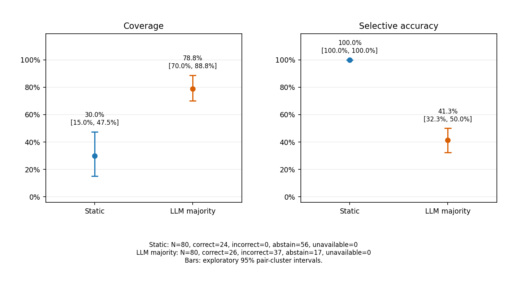
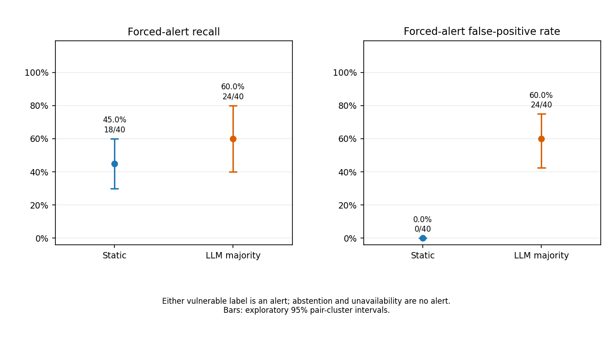
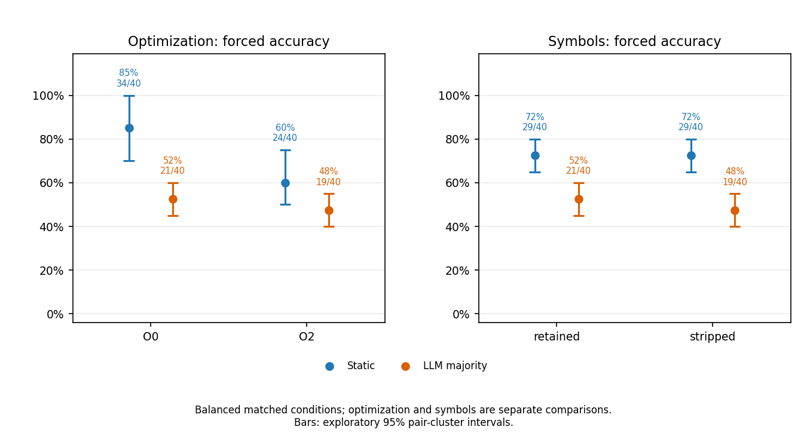

# Final analysis

80 observations from 10 held-out pairs; pilot pairs are excluded.

Intervals are exploratory 95% pair-cluster percentile intervals. With only 10 clusters they may be unstable; they are not confirmatory significance tests.

## Three-way performance

| Method | N | Correct | Incorrect | Abstain | Unavailable | Correct/N (95% interval) | Coverage (95% interval) | Selective accuracy (95% interval) |
|---|---:|---:|---:|---:|---:|---|---|---|
| Static | 80 | 24 | 0 | 56 | 0 | 30.0% [15.0%, 47.5%] | 30.0% [15.0%, 47.5%] | 100.0% [100.0%, 100.0%] |
| LLM majority | 80 | 26 | 37 | 17 | 0 | 32.5% [25.0%, 40.0%] | 78.8% [70.0%, 88.8%] | 41.3% [32.3%, 50.0%] |

Abstention rates (95% intervals): Static 70.0% [52.5%, 85.0%]; LLM majority 21.2% [11.2%, 30.0%].

Unavailability rates (95% intervals): Static 0.0% [0.0%, 0.0%]; LLM majority 0.0% [0.0%, 0.0%].

CWE labels are indivisible: a wrong-CWE alert is three-way incorrect. Both uncertainty types abstain; unavailable is separate.

## Forced binary alerts

| Method | TP | TN | FP | FN | TN from abstain | TN from unavailable | FN from abstain | FN from unavailable | Wrong-CWE alerts |
|---|---:|---:|---:|---:|---:|---:|---:|---:|---:|
| Static | 18 | 40 | 0 | 22 | 34 | 0 | 22 | 0 | 0 |
| LLM majority | 24 | 16 | 24 | 16 | 8 | 0 | 9 | 0 | 6 |

Either vulnerable label is an alert. Explicit safe decisions, abstentions, and unavailable results all become no alert; their TN/FN contributions above remain distinct.

| Forced metric | Static (95% interval) | LLM majority (95% interval) |
|---|---|---|
| accuracy | 72.5% [65.0%, 80.0%] | 50.0% [43.8%, 56.2%] |
| balanced_accuracy | 72.5% [65.0%, 80.0%] | 50.0% [43.8%, 56.2%] |
| precision | 100.0% [100.0%, 100.0%] | 50.0% [44.4%, 55.0%] |
| recall | 45.0% [30.0%, 60.0%] | 60.0% [40.0%, 80.0%] |
| f1 | 62.1% [46.2%, 75.0%] | 54.5% [42.7%, 63.4%] |
| fpr | 0.0% [0.0%, 0.0%] | 60.0% [42.5%, 75.0%] |
| fnr | 55.0% [40.0%, 70.0%] | 40.0% [20.0%, 60.0%] |

## Paired method differences

LLM majority minus static, in percentage points; shared sampled weights are used on both sides.

| Primary metric | Difference [95% interval], pp | Defined replicates |
|---|---:|---:|
| correct_rate | 2.5 [-20.0, 23.8] | 10000/10000 |
| coverage | 48.8 [30.0, 66.3] | 10000/10000 |
| recall | 15.0 [-5.0, 32.5] | 10000/10000 |
| fpr | 60.0 [42.5, 75.0] | 10000/10000 |

## Matched treatment contrasts

Every comparison retains the same pairs and matched variant/other-treatment cells. Values are forced accuracy.

| Method | O0 (95% interval) | O2 (95% interval) | O2 minus O0, pp [95% interval] |
|---|---|---|---|
| Static | 85.0% [70.0%, 100.0%] | 60.0% [50.0%, 75.0%] | -25.0 [-45.0, -5.0] |
| LLM majority | 52.5% [45.0%, 60.0%] | 47.5% [40.0%, 55.0%] | -5.0 [-15.0, 7.5] |

| Method | retained (95% interval) | stripped (95% interval) | stripped minus retained, pp [95% interval] |
|---|---|---|---|
| Static | 72.5% [65.0%, 80.0%] | 72.5% [65.0%, 80.0%] | 0.0 [0.0, 0.0] |
| LLM majority | 52.5% [45.0%, 60.0%] | 47.5% [40.0%, 55.0%] | -5.0 [-15.0, 7.5] |

## LLM stability and confidence

Three valid runs: 76/80 observations. All three decisions identical (all valid): 44/80.

Pooled pairwise agreement among valid runs: 160/232 (69.0%). Failed runs are excluded from this denominator, not replaced by uncertainty.

Invalid run counts: empty_response=0, invalid_json=0, length_limit=4, schema_invalid=0, timeout=0, transport_error=0.

Model-produced uncertain votes: 38; majority-uncertain observations: 9; insufficient-agreement observations: 8; all-unavailable observations: 0.

Median observation confidence by three-way outcome: correct=0.9, incorrect=0.9, abstain=0.8. Confidence for each observation is the median over all its valid runs.

High-confidence three-way errors at confidence >= 0.8: 37.

## Interpretation and regeneration

65 metric rows have fewer than all bootstrap replicates defined.

Undefined denominators are NA (blank CSV cells), never zero. Intervals use only jointly defined replicates; every metric row reports bootstrap_defined/bootstrap_total. Sparse subgroup intervals are conditional on defined replicates.

Bootstrap: 10000 draws of 10 pairs with replacement; PCG64 seed 20261014; linear 2.5th/97.5th percentiles. All methods, subgroups, and matched contrasts share the same draws.

Full counts, rates, and intervals are in summary.csv and subgroups.csv; per-observation votes, failures, and confidence are in stability.csv. These results concern selected target operations in this small corpus, compiler, extractor, and local model. They do not establish production-scanner performance.

